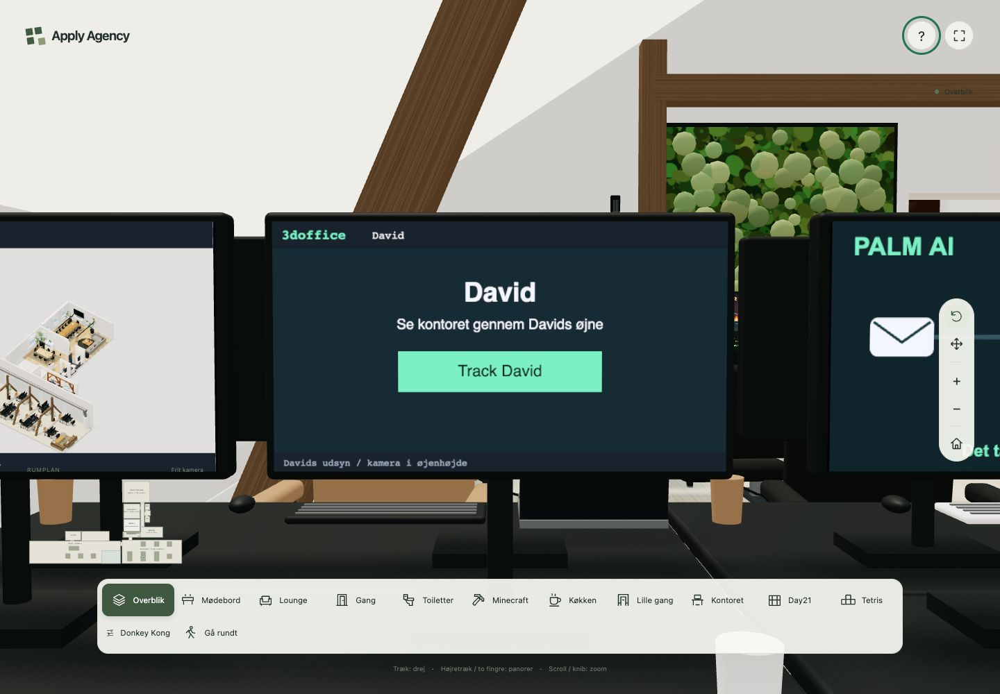
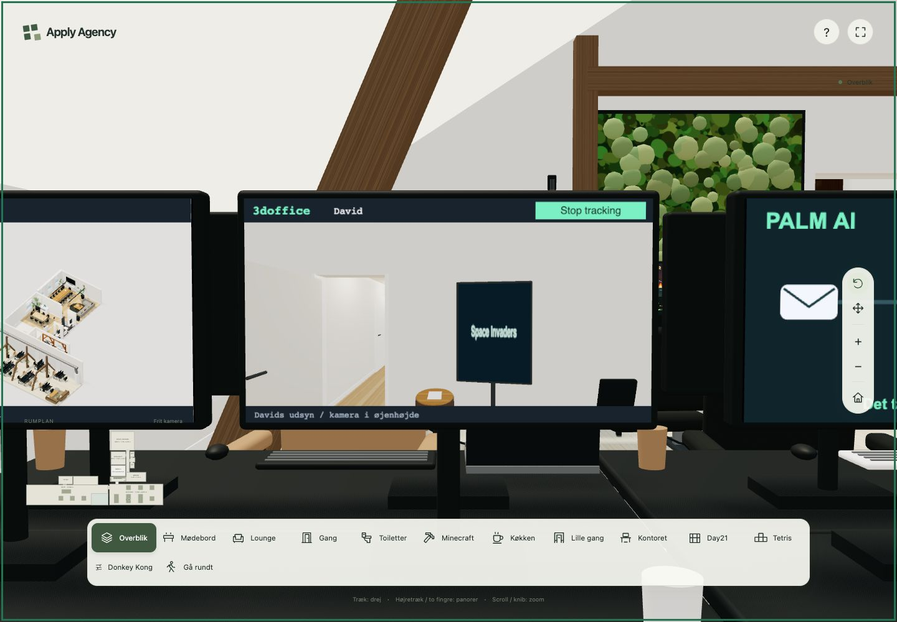

# Plan 7 — udskudte captures og synlighed

Implementeret 18. oktober 2026 på `performance`. Baseline er `d0bfd0b` (plan 2–6); slutkoden er `a3eb456`, med Track David i `4ea180d`, køprioritering i `0ac1c43` og reviewrettelser i `986893c`. Ingen deployment.

Plan 7A–D og den tilknyttede Track David-plan er gennemført. Første overblik kræver stadig nul Holbech-targets og nul offscreen-renderinger. Nærvisning opretter kun oversigten; Davids kamera kræver nu et klik. YouTube undersøger kun geometri langs de fem synslinjer og genbruger resultatet, når kamera og relevante objekter er uændrede.

## Måleforhold

Lokal M3 Pro, Chromium 151.0.7922.34 med Metal, viewport 1440 × 1000, DPR 1, Node 24.11.0. Produktionsbuild, base `/3doffice/dist/`, baseline på port 4177 og efter på 4175. Browserkørsler blev udført sekventielt. Ingen CPU-/netværksthrottling bortset fra den særskilte forsinkelsestest. YouTube blev erstattet med en lokal HTML-fixture via request routing; iframe-oprettelse og unload testes, ikke selve YouTube-tjenesten.

Opstart/gåtur bruger reduceret bevægelse og en fast tilfældighedssekvens. Nærvisnings- og trackingprofiler bruger normal animation. Alle render- og callbacktider er instrumenterede **CPU-tider**, ikke GPU-tider eller garantier om FPS/mobilperformance. Tælleren omkring `Mesh.raycast` inkluderer også instansers interne meshkald og medfører selv overhead.

## Opstart og gåtur

Fem kolde og fem varme besøg pr. revision, median:

| Måling | Før | Efter |
| --- | ---: | ---: |
| Første brugbare 3D-frame, kold | 414,0 ms | 429,7 ms |
| Første brugbare 3D-frame, varm | 384,5 ms | 376,2 ms |
| Oprettelse af grundscene, kold | 117,6 ms | 120,1 ms |
| Oprettelse af grundscene, varm | 79,3 ms | 79,0 ms |
| Holbech-targets ved første frame | 0 | 0 |
| Offscreen-renderinger ved første frame | 0 | 0 |
| GPU-teksturer ved første frame, nærvisningsprofil | 50 | 50 |

Plan 3 havde allerede flyttet Holbech væk fra første frame. Plan 7 viser ikke en entydig forbedring af første frame: kold median stiger 3,8 %, varm falder 2,2 %. Gevinsten ligger i ressourceoprettelse ved nærvisning og det løbende synlighedsarbejde.

| Fast gåtur | Frameinterval før, median / p95 / max | Efter, median / p95 / max |
| --- | --- | --- |
| Kontoret | 8,3 / 8,4 / 9,1 ms | 8,3 / 9,0 / 16,7 ms |
| Day21 | 8,3 / 8,6 / 9,3 ms | 8,3 / 9,2 / 16,6 ms |

Grundscenen, navigation og skygger er bevaret. Overblikkets hovedrender har 4.417 draw calls inklusive 2.047 shadow draw calls på begge revisioner. Kontoret har 3.238 / 2.624; Day21 2.974 / 2.624. GPU-hukommelsestællere på ruten er uændrede: Kontoret 1.456 geometrier / 54 teksturer, Day21 1.458 / 54. Dette er rendererkonti, ikke hukommelsesbytes.

Rådata: [opstart før](startup-before.json), [opstart efter](startup-after.json), [gåtur og skygger](shadow-walk.json). Overblik og rumvisninger findes som `startup-before-*.jpg` og `startup-after-*.jpg`.

## 7A og Track David

Ved nærvisning før klik går antallet af Holbech-targets fra **2 til 1** og renderers samlede teksturtæller fra **84 til 52**. Teksturforskellen omfatter også indhold, som det tidligere livekamera fik uploadet; den er ikke alene størrelsen af ét target.

Mus og touch starter og stopper kameraet fra den tegnede knap. Targetets texture UUID er identisk efter anden aktivering. Reduceret bevægelse giver præcis ét capture pr. aktivering. Stop, sene asset-invalidationer og afgang under åben hjælp giver ingen efterfølgende liveoptagelser. Gåtilstand og tastaturkontrol efter knaptryk er verificeret. Fejltesten gendanner tidligere render target, vægge, tage, David og materialer og beviser, at capture-fejl ikke starter en retry-løkke.

Samme nærvisning, normal animation; callback-tider median / p95 / maksimum:

| Tilstand | Før | Efter | David-renderinger før → efter |
| --- | --- | --- | ---: |
| Før klik, 1,8 s | 4,1 / 7,4 / 15,9 ms | 4,3 / 5,9 / 16,5 ms | 23 → 0 |
| Aktiv tracking, 3 s | 3,9 / 10,7 / 11,7 ms | 4,2 / 11,1 / 15,8 ms | 36 → 34 |
| Efter Stop, 1,8 s | 3,9 / 10,5 / 11,5 ms | 3,8 / 4,4 / 11,3 ms | 21 → 0 |
| Efter afgang, 1 s | 6,6 / 7,1 / 7,6 ms | 6,7 / 7,3 / 8,0 ms | 0 → 0 |
| Tilbage uden klik, 1,8 s | 4,0 / 10,2 / 11,5 ms | 4,1 / 4,8 / 5,4 ms | 22 → 0 |

Alle disse tilstande har nul callbacks over 50 ms. Første aktive David-render efter klik tager **12,4 ms CPU**, med 3.518 draw calls inklusive skygger. Aktiveringsvinduets højeste callback er **18,6 ms**; det opgøres særskilt fra stabil tracking. Første capture allokerer target og udfører renderarbejde; allokeringens del er ikke isoleret fra renderkaldet.

Under tre sekunders aktiv tracking koster Davids 34 renderinger tilsammen 220,4 ms CPU og 144.802 draw calls, heraf 85.204 shadow draw calls. Hovedkameraet udfører 361 renderinger og 987.696 draw calls. Efter Stop og ved genbesøg er David-renderinger og hans ekstra shadow draw calls præcis nul. Optimeringen fjerner inaktivt arbejde; den aktive optagelse koster fortsat cirka 6,5 ms CPU pr. capture i denne måling.

Review fandt og rettede manglende canvasfokus ved knapklik, manglende tone mapping af lineære captureteksturer og asset-invalidationer, der kunne omgå 12 Hz-grænsen. Regressionsprøver dækker alle tre.

Rådata: [tracking før](track-before.json), [tracking efter](track-after.json), [mus/touch](controls.json), [gåtilstand](controls-walking.json). `startup`-segmentet i trackingfilerne indeholder også indzoomning; kun `first` i nærvisningsprofilerne angiver selve første frame.

## 7B: oprettelse og prioritering

Endnu ikke påbegyndte imports, constructors og billedjobs nedprioriteres nu ved ændret kameravisning. En import, der allerede kører, kan afslutte, men dens efterfølgende constructor bruger den aktuelle prioritet. Nye køjobs starter fortsat én pr. browserturn; skjult fane pauser køen. Ingen ny scheduler eller loader er tilføjet.

| Synkron constructor inkl. canvasarbejde | Før | Efter |
| --- | ---: | ---: |
| Holbech | 4,2 ms | 3,5 ms |
| Henrik | 7,4 ms | 6,0 ms |
| Jesper | 2,4 ms | 2,5 ms |
| Palm | 1,6 ms | 1,4 ms |
| YouTube | 2,0 ms | 1,5 ms |

Chromiums særskilte trace registrerer `v8.evaluateModule`: første evaluering, inklusive grundsceneoprettelse, er 193,3 / 207,5 ms før/efter. De efterfølgende 16 evalueringer summerer til 6,7 / 7,2 ms og har maksimum 6,2 / 6,4 ms. Traceeventene angiver ikke modul-URL, så de tilskrives ikke individuelle controllers. Importløfternes elapsed-tid indeholder netværk og scheduling og bruges **ikke** som evalueringstid.

WebGL uploadkald (`texImage2D`, `texSubImage2D`, `texStorage2D`) bruger i alt 2,8 / 2,4 ms CPU under Holbech-nærvisningen. Største uploadkald i hele profilen er 7,6 / 7,3 ms. Det måler tid i browserkaldet, ikke GPU-komplettering.

**Resterende long tasks:** I nærvisningsprofilen er der to opstarts-long-tasks før (233 og 190 ms) og efter (246 og 205 ms). Første Holbech-nærvisning har én på 141 / 117 ms. Første oversigtsrender alene tager 112,2 / 106,3 ms CPU; senere oversigtsrenders ligger hovedsageligt omkring 7–8 ms. Det første capture er derfor fortsat en synlig risiko for et kort hak. Controller-opgaverne er allerede korte; som tilladt i 7B er der ikke tilføjet yderligere opdeling af dem. Selve rendererens første offscreen-pass er ikke opdelt eller gjort asynkront.

Ved 1.200 ms kunstig forsinkelse af Henrik-chunken reagerer touch-zoom på 65,8 ms inklusive automationens ventetid, og skærmindholdet bliver klart efter 1.250 ms. Tetris åbner, flytter brikken og pauser via touch, mens resten af indlæsningen bevares.

Rådata: [før](before.json), [efter](after.json), [modulevaluering før](trace-before-evaluation.json), [efter](trace-after-evaluation.json), [forsinket modul og touch](touch-delay.json).

## 7C–D: kandidater og cache

World-space bounds udvælger objekter langs hele volumenet fra kameraet til skærmens fem samples. Bevægelige objekter kontrolleres ved hver forespørgsel. Cache genbruges kun, hvis kamera/projektion/skærm og kandidaternes revisioner er identiske. Der er ingen generel timer eller input-throttle. Tilføjelser/fjernelser opdaterer det fælles registry; instansmatrix, antal instanser og ændret geometri opdaterer bounds.

Samme stationære YouTube-visning, 1,8 sekunders interval:

| Måling | Før | Kun kandidatfiltrering | Filtrering + cache |
| --- | ---: | ---: | ---: |
| Kandidatmeshes | Hele scenen | 6 af 2.909 | 6 af 2.909 |
| `Mesh.raycast`-kald | 3.510.912 | 130.680 | 0 |
| CPU i disse raycast-kald | 484,7 ms | 32,5 ms | 0 ms |
| Callback median / p95 | 10,1 / 17,8 ms | 5,5 / 6,2 ms | 6,3 / 8,6 ms |

Den cachede version udfører fem stråler ved første relevante kontrol og genbruger derefter resultatet 258 gange i hele YouTube-segmentet. Nul i tabellen gælder det efterfølgende stationære målevindue. Bounds og almindeligt scene-/animationsarbejde fortsætter; nul raycasts betyder ikke nul CPU. Forskellen mellem de to optimerede callbackmålinger viser også, at en enkelt lokal profil ikke beviser lavere samlet callbacktid fra caching alene.

Unit-tests sammenligner med komplette scene-raycasts for bagfra, skjulte forældre, hjørneblokering, flyttet/roteret dør, en blocker tæt på kameraet langt fra skærmen, lazy-tilføjelse/fjernelse, instancing og ændret geometri. Uafhængigt review udførte yderligere 1.000 sammenligninger, inklusive spejlede objekter: nul uoverensstemmelser.

Browserkontrol tilføjer, flytter, skjuler og fjerner en blocker ved stationært kamera. Overlayet reagerer uden en ekstra throttle. Hurtigt kameradrej skjuler også laget. Hjælp, TV-spil og afstand over 5 m fjerner iframe-src. Et simuleret `document.hidden` + `visibilitychange` fjerner src og skjuler laget synkront samt pauser køen; dette er en test af visibility-handleren, ikke en OS-baggrundstest. Genbesøg indlæser iframe igen.

Rådata: [kun kandidater](candidates.json), [cache](after.json), [browserforløb](youtube-flows.json).

## Verifikation og reproduktion

- `pnpm test`: **151 bestået**, inklusive relevante invalidation-, pointer-, pause- og fejlprøver. [Output](tests.txt).
- `pnpm build`: bestået. Den eksisterende advarsel om Three.js-chunkens størrelse er fortsat til stede. [Output](build.txt).
- `pnpm check:bundle`: bestået, initial JavaScript **197.946 bytes gzip**, budget 204.672. [Rapport](bundle.txt).
- Produktionsbrowser: nul registrerede JS-fejl i alle gemte forløb; overblik, Kontoret, Day21, køkken, gåtilstand, mus, touch, reduceret bevægelse, TV, whiteboard og Tetris kontrolleret. Whiteboard registrerer fem streger og starter uden mikrofon; afgang pauser og slukker sensorer. Kaffeknap giver ét tryk. [Resultater](more-flows.json).
- Whiteboard-testens første forsøg skiftede kamera før TV-dialogens asynkrone close-event. Testen venter nu på afsluttet lukning; der krævedes ingen produktionsrettelse.

Målescripts ligger i [reproduce](reproduce/). De køres fra repository-roden med `PLAYWRIGHT_MODULE` sat til en eksisterende Playwright-installation. `profile.mjs`, `trace.mjs` og `track-profile.mjs` tager port og resultatnavn. Interaktionsscripts bruger port 4175; `shadow-walk.mjs` bruger 4177 og 4175. Opstart gentages med det eksisterende `scripts/measure-performance.mjs`, `PERF_OUTPUT=docs/plans/performance/results/07` og argumenterne `4177 startup-before` / `4175 startup-after`. Genkørsel erstatter filer med samme resultatnavn. Baseline kræver et separat build af `d0bfd0b`; after kræver `pnpm build` på slutrevisionen.
